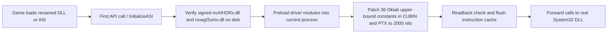

# RTX HDR Unlock

**English** | **[简体中文](README.zh-CN.md)**

RTX HDR Unlock fixes a long-standing issue that has affected NVIDIA RTX HDR since release: even when the slider allows up to **2000 nits**, the internal tone-mapping kernel clips highlights around **1000 nits**.

This project raises the internal highlight ceiling in memory to a true **2000 nits**, while keeping NVIDIA's original Oklab gamut-mapping path and normal brightness control intact.

## What Problem This Fixes

In standard RTX HDR, setting peak brightness above 1000 nits (for example **2000 nits**) still hits an internal 1.0 normalized ceiling (`1.0 = 1000 nits`). Bright highlights flatten around **1000 nits**, and bright steps near white merge into the same value.

With this DLL loaded:

- The internal clipping ceiling becomes **2000 nits**.
- Your actual target peak still comes from your **NVIDIA App / RTX HDR Peak Brightness** setting.
- If your display is **2000 nits**, keep NVIDIA set to **2000**; it does **not** force every scene to 2000 nits.
- System driver files on disk are never modified.

## How to Use

### 1. Build or obtain `RtxHdrUnlock.dll`

One compiled binary works as a proxy DLL or as an `.asi` plugin.

### 2. Place it next to the game's main `.exe`

Copy `RtxHdrUnlock.dll` into the same folder as the target executable, then rename it to **one** DLL name that the game actually loads:

- `dxgi.dll` (good default for most DirectX 11 / 12 games)
- `winmm.dll`
- `version.dll`
- `winhttp.dll`
- `psapi.dll`

Or, if the game already uses an ASI Loader, rename it to any `.asi` name such as:

- `RtxHdrUnlock.asi`

### 3. Launch the game

When the file loads, it creates `RtxHdrUnlock.log` in the same folder and clears previous log contents on every new load:

- `DLL_LOADED`: the file was loaded into the process.
- `PATCH_READY`: both NVIDIA HDR driver modules and both GPU code sources (`CUBIN` and `PTX`) were verified and patched in memory.
- `REJECTED`: the driver version, GPU architecture, or module state did not match, so nothing was changed.

### Important Notes

- Do **not** overwrite a file that the game itself already ships in that folder, and do not overwrite an existing ReShade / Special K proxy. Pick another supported filename instead.
- `psapi.dll` is listed in Windows `KnownDLLs`. Normal name-based imports load Windows' system copy first, so `psapi.dll` only works when a host or loader explicitly loads the local file by full path. For ordinary game folder placement, prefer `dxgi.dll`, `winmm.dll`, `version.dll`, or `winhttp.dll`.
- `.asi` mode requires an ASI Loader that calls `InitializeASI` outside `DllMain` before RTX HDR initializes.
- To uninstall, close the game and delete the DLL / ASI file (and `RtxHdrUnlock.log` if present).

## How It Works

NVIDIA's `truehdr_drtm` CUDA kernel receives the user's configured peak brightness, divides it by `1000.0`, and uses that normalized value during tone mapping. However, the Oklab gamut-mapping stage still contains hard-coded upper bounds for a `1000`-nit ceiling:

1. An upper domain tolerance check at `1.001` (`(1000 + 1) / 1000`).
2. Final channel clamp instructions capped at `1.0` (`1000 / 1000`).

Because of those constants, values above `1.0` are pulled back to roughly 1000 nits even when the kernel parameter requests 2000 nits.

`RtxHdrUnlock.dll` fixes this in process memory before RTX HDR runs:

1. In `DllMain`, it only records the module handle and writes the initial `DLL_LOADED` line to `RtxHdrUnlock.log`. It avoids heavy work inside the Windows loader lock.
2. On the first forwarded export call (or `InitializeASI`), it locates the active signed NVIDIA driver folder, verifies the SHA-256 of `nvAIHDRx.dll` and `nvwgf2umx.dll` on disk, and preloads them into the current process.
3. It checks that the embedded original `truehdr_drtm` **CUBIN** (`113,216` bytes) and **PTX** (`244,273` bytes) match the known SHA-256 hashes.
4. It patches only the **36** upper-bound constants across the three Oklab clamp paths (`18` tolerance values to `2.001` and `18` final clamp values to `2.0`), preserving the exact blob lengths, register count, and surrounding algorithm.
5. Every write is verified by readback. If any step fails, all modified bytes and memory protections are rolled back automatically.



## How to Build

### Prerequisites

- Windows 10 / 11 x64
- Python 3 with `pefile` (`pip install pefile`)
- LLVM `clang-cl.exe` (`C:/Program Files/LLVM/bin/clang-cl.exe`)
- Visual Studio 2022 `ml64.exe` (or LLVM `llvm-ml64.exe`) and Windows SDK libraries

If your `clang-cl.exe` or `ml64.exe` is installed in a different path, update the two path variables at the top of `tools/build_proxy.ps1`.

### Build Command

Run from the repository root in PowerShell:

```powershell
powershell -NoProfile -ExecutionPolicy Bypass -File .\tools\build_proxy.ps1
```

The build script:

1. Runs `tools/generate_proxy_exports.py` against your local `System32` DLLs (`dxgi`, `winmm`, `version`, `winhttp`, `psapi`) to generate x64 assembly forwarding thunks (`analysis/proxy_build/universal/`).
2. Assembles the thunks, preserving integer registers (`RCX`, `RDX`, `R8`, `R9`), `XMM0–XMM3`, and caller stack arguments.
3. Compiles `src/proxy.cpp` into `dist/RtxHdrUnlock.dll`.

## Compatibility & Safety

- Currently locked to **NVIDIA Driver 621.01 (`32.0.16.2101`) x64** and **Ada (`SM 8.9`)** hashes for safety.
- If a future driver changes `nvAIHDRx.dll`, `nvwgf2umx.dll`, or the embedded kernel bytes, the DLL refuses to patch and still forwards normal system DLL calls cleanly.
