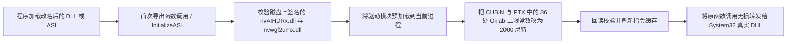

# RTX HDR Unlock

**[English](README.md)** | **简体中文**

RTX HDR Unlock 用于修复 NVIDIA RTX HDR 自发布以来一直存在的 **1000 尼特高光裁切（clipping）问题**：即使界面里把峰值亮度调到 **2000 尼特**，驱动内部的色调映射内核仍会在 **1000 尼特** 左右把高光压平。

本项目通过进程内内存补丁把内部高光上限真正提升到 **2000 尼特**，同时完整保留原有的 Oklab 色域映射与正常的峰值亮度调节逻辑。

## 解决什么问题

在原版 RTX HDR 中，哪怕将峰值亮度设到 1000 尼特以上，内部仍会撞上 `1.0` 的归一化上限（`1.0 = 1000 尼特`）。结果就是画面最亮处在 **1000 尼特** 附近变成平台，接近纯白的高光层次会糊成同一亮度。

加载本 DLL 后：

- 内部裁切上限提升为真正的 **2000 尼特**。
- 实际输出目标亮度仍然由 **NVIDIA App / RTX HDR 峰值亮度滑块** 决定。
- 如果你的显示器峰值是 **2000 尼特**，NVIDIA 里继续设 **2000** 即可，不会把所有画面强行拉到 2000 尼特。
- 不会修改磁盘上的系统驱动文件。

## 如何使用

### 1. 编译或获取 `RtxHdrUnlock.dll`

同一个 DLL 文件既可以改名当系统代理 DLL 使用，也可以直接改成 `.asi` 插件使用。

### 2. 放到目标程序（游戏）主 `.exe` 同目录

把 `RtxHdrUnlock.dll` 复制到主程序所在目录，并改名为目标程序实际会加载的**任意一个**名字：

- `dxgi.dll`（大多数 DirectX 11 / 12 游戏优先推荐）
- `winmm.dll`
- `version.dll`
- `winhttp.dll`
- `psapi.dll`

如果游戏本身已经装有 ASI Loader，也可以改成任意 `.asi` 文件名，例如：

- `RtxHdrUnlock.asi`

### 3. 启动程序并查看日志

DLL 被加载后，会在同目录自动生成 `RtxHdrUnlock.log`，并在每次重新加载时自动清空旧内容：

- `DLL_LOADED`：DLL 已被进程加载，等待首次代理调用或 `InitializeASI`。
- `PATCH_READY`：两个 NVIDIA HDR 驱动模块以及其中的 `CUBIN` 和 `PTX` 两套内核代码均已通过校验并完成内存写入。
- `REJECTED`：驱动版本、显卡架构或内存内容不匹配，未做任何修改。

### 注意事项

- **不要覆盖**游戏目录里原本就存在的同名 DLL，也不要直接覆盖已有的 ReShade / Special K 代理文件；如果有冲突，换用列表中的其它文件名即可。
- `psapi.dll` 在 Windows 中属于 `KnownDLLs`。普通按名称导入会直接走系统目录的 `psapi.dll`，只有宿主或加载器按完整路径显式加载本地文件时才会生效。常规放游戏目录请优先用 `dxgi.dll`、`winmm.dll`、`version.dll` 或 `winhttp.dll`。
- `.asi` 模式需要已有的 ASI Loader 在 `DllMain` 之外调用 `InitializeASI`，并且早于首次 RTX HDR 初始化。
- 卸载时，关闭游戏并删除你放入的 DLL / ASI 文件（以及 `RtxHdrUnlock.log`）即可。

## 工作原理

NVIDIA 的 `truehdr_drtm` CUDA 内核会读取用户设置的峰值亮度，并除以 `1000.0` 作为归一化参数参与计算；但在 Oklab 色域映射阶段，代码里仍写死了对应 **1000 尼特** 的上限常数：

1. 上界容差判断固定为 `1.001`（即 `(1000 + 1) / 1000`）。
2. 最终通道钳制上限固定为 `1.0`（即 `1000 / 1000`）。

因此，即使传入了 2000 尼特的参数，超过 `1.0` 的高亮部分依然会在最后阶段被截回约 1000 尼特。

`RtxHdrUnlock.dll` 在 RTX HDR 真正初始化前，在当前进程内存里完成修复：

1. 在 `DllMain` 中只记录模块句柄，并向 `RtxHdrUnlock.log` 写入 `DLL_LOADED`，不在系统加载器锁内执行重操作。
2. 当目标程序第一次调用被代理的导出函数（或 ASI Loader 调用 `InitializeASI`）时，定位当前生效的签名 NVIDIA 驱动目录，先校验磁盘上 `nvAIHDRx.dll` 与 `nvwgf2umx.dll` 的 SHA-256，再将它们预加载进当前进程。
3. 校验内存中内嵌的原始 `truehdr_drtm` **CUBIN**（`113,216` 字节）和 **PTX**（`244,273` 字节）SHA-256。
4. 仅修改三段 Oklab 钳制路径中的 **36 处**上界常数（`18` 处容差改为 `2.001`，`18` 处最终上限改为 `2.0`），保持二进制长度、寄存器占用和其余算法完全不变。
5. 每次写入后都立即回读比对；一旦任一步骤失败，会把已修改字节和页面保护全部回滚到原始状态。



## 如何构建

### 环境要求

- Windows 10 / 11 x64
- Python 3，并安装 `pefile`（`pip install pefile`）
- LLVM `clang-cl.exe`（默认路径：`C:/Program Files/LLVM/bin/clang-cl.exe`）
- Visual Studio 2022 `ml64.exe`（或 LLVM `llvm-ml64.exe`）及 Windows SDK

如果你的 `clang-cl.exe` 或 `ml64.exe` 安装在其它位置，修改 `tools/build_proxy.ps1` 顶部的两个路径变量即可。

### 编译命令

在仓库根目录用 PowerShell 执行：

```powershell
powershell -NoProfile -ExecutionPolicy Bypass -File .\tools\build_proxy.ps1
```

构建脚本会：

1. 调用 `tools/generate_proxy_exports.py` 扫描本机 `System32` 下的 `dxgi`、`winmm`、`version`、`winhttp`、`psapi` 导出表，生成保持 x64 调用约定的汇编转发桩（输出到 `analysis/proxy_build/universal/`）。
2. 汇编转发桩，完整保留整数寄存器（`RCX`、`RDX`、`R8`、`R9`）、浮点寄存器（`XMM0–XMM3`）与调用方栈参数。
3. 编译 `src/proxy.cpp`，在 `dist/RtxHdrUnlock.dll` 生成最终单文件 DLL。

## 兼容性与安全性

- 为保证安全，当前版本严格绑定已验证的 **NVIDIA 621.01（`32.0.16.2101`）x64** 驱动文件哈希与 **Ada（`SM 8.9`）** 内核哈希。
- 如果驱动更新导致 `nvAIHDRx.dll`、`nvwgf2umx.dll` 或内核字节发生变化，DLL 会自动拒绝打补丁，同时继续正常转发系统 DLL 调用，不会破坏原程序运行。
